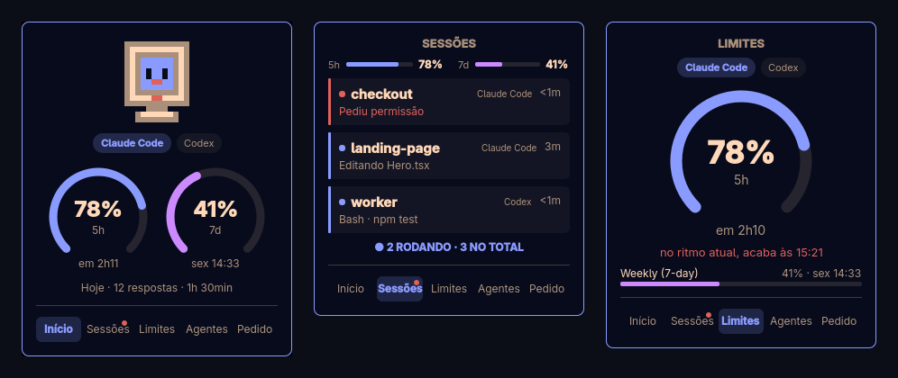

# Agent Pet

**A tiny retro computer on the Omarchy bar that keeps an eye on your coding agents.**



Agent Pet watches your local **Claude Code** and **Codex** sessions and shows,
at a glance, who is working, who is waiting for you and how much of each
agent's usage limit is left. The little computer on the bar changes face with
the state of your sessions: it works, celebrates, sleeps, and blinks red when an
agent asks for permission.

> The interface is in Brazilian Portuguese.

## Screens

A small menu at the bottom of the panel switches between:

- **Início** — the pet, one circular gauge per usage window of the selected
  agent (Claude Code 5h/7d, Codex 30d) and today's completed replies and active
  time.
- **Sessões** — one card per session: project, agent, current activity
  (`Editando Hero.tsx`, `Bash · npm test`) and how long it has been running.
- **Limites** — the main window of the selected agent in a big gauge and, when
  the current pace would run out before the reset, the time it would happen.
- **Pedido** — opens by itself when a session asks for permission: project,
  the requested command (`Bash: npm run migrate`) and how long it has waited.
- **Agentes** — every agent Omarchy tracks, with a switch to hide it (and its
  sessions and gauges) from the other screens.

## Install

```bash
omarchy plugin add https://github.com/MarlonAzevedo/omarchy-agent-pet.git --enable
~/.config/omarchy/plugins/io.github.marlonazevedo.agent-pet/bin/agent-pet setup
```

`--enable` puts the pet on the right side of the bar. `agent-pet setup` asks for
confirmation and then adds asynchronous hooks to `~/.claude/settings.json` and,
when Codex is installed, to `~/.codex/hooks.json`. Both files are backed up first
and your existing hooks are kept. Codex runs new hooks only after you review and
trust them: open Codex and run `/hooks`.

The widget stays hidden until a session starts.

### Requirements

- Omarchy 4 (Omarchy Shell) and `python3`.
- Claude Code and/or Codex. Usage limits come from Omarchy's own collectors
  (`omarchy.agents`); for Codex, install it the Omarchy way
  (`omarchy-mise-install codex`) so the collector can find it.

### Update

```bash
omarchy plugin update io.github.marlonazevedo.agent-pet
omarchy-restart-shell
```

### Remove

```bash
omarchy plugin remove io.github.marlonazevedo.agent-pet
rm -rf ~/.local/state/agent-pet ~/.config/agent-pet   # optional: state and settings
```

Then delete the hook entries that run `pet-hook.py` from
`~/.claude/settings.json` and `~/.codex/hooks.json`.

## Privacy

Everything stays on your machine; nothing is sent over the network and no
transcript is read. Each session is a small JSON file in
`~/.local/state/agent-pet/sessions/` (mode `600`) with status, project folder,
current tool and a short tool summary: a file name, a search pattern or the first
line of a shell command cut at 60 characters. Desktop notifications show only the
tool name and folder.

## Settings

`~/.config/agent-pet/config.json`:

| Key | Default | |
|---|---|---|
| `notifications_enabled` | `true` | Desktop notification when an agent needs you. |
| `hidden_agents` | `[]` | Agent ids hidden in the panel; managed by the **Agentes** screen. |

## Development

```bash
python3 -B -m unittest discover -s testes -t .
node testes/model.test.mjs
QT_QPA_PLATFORM=offscreen qml6 -I testes/painel/imports testes/painel/render.qml -- /tmp/agent-pet-render
```

The last command renders every panel screen with test data, outside the shell.
After changing QML in an installed copy, run `omarchy-restart-shell`: the shell's
hot reload keeps components it already compiled.

## Português

Agent Pet é um computadorzinho na barra do Omarchy que acompanha as sessões
locais do Claude Code e do Codex: quem está trabalhando, quem precisa de você,
os limites de uso de cada agente e o resumo do dia. Instale com os dois comandos
da seção **Install**, aprove os hooks no Codex com `/hooks` e pronto. Tudo fica
na sua máquina.

## License

[MIT](LICENSE)
